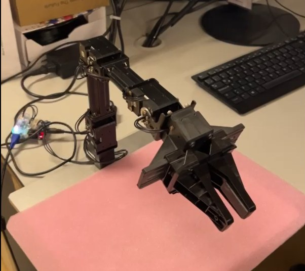
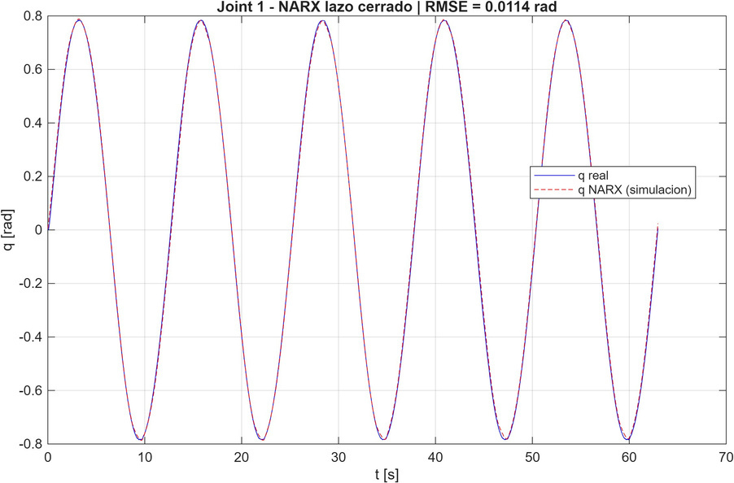
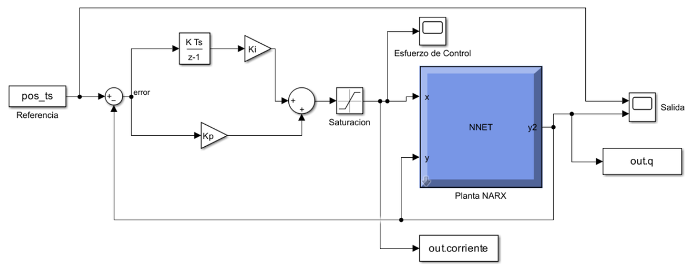
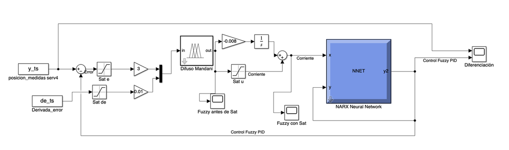
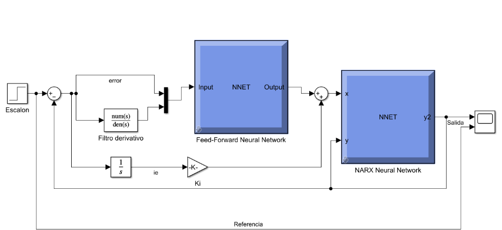
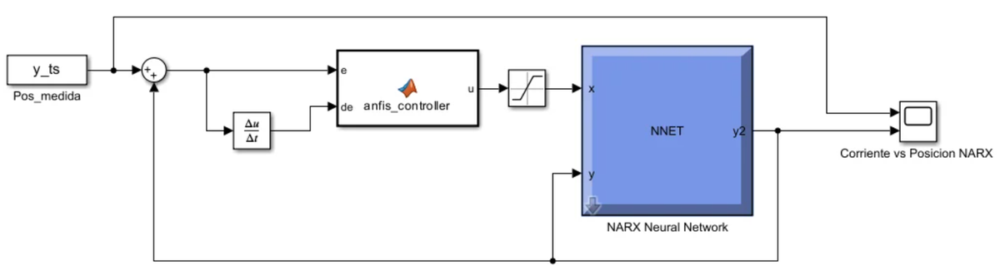
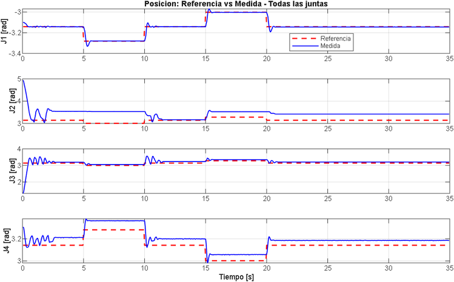
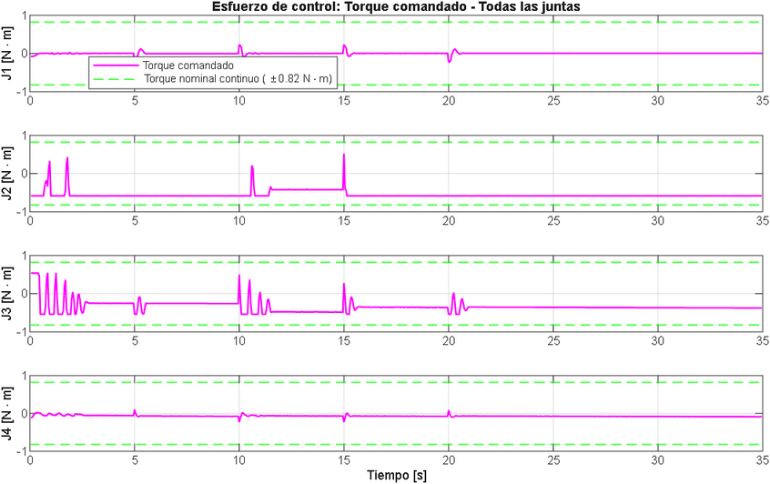
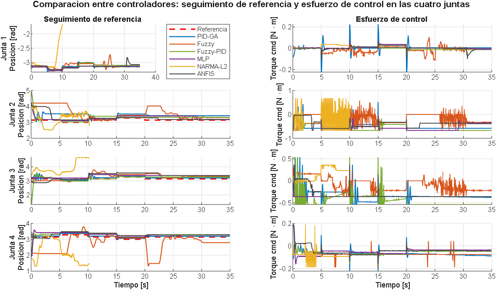
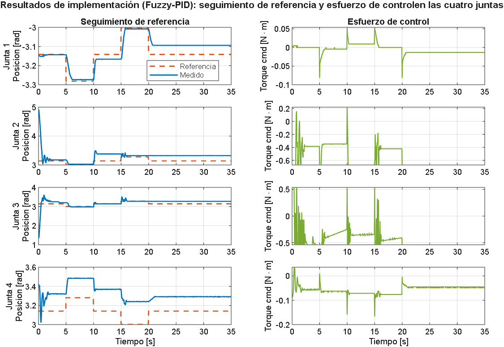

# OpenMANIPULATOR-X: Current-Based Classical & Intelligent Joint Control

[-1F2937?style=flat-square)](#experimental-hardware-validation)
[-2EA043?style=flat-square)](#narx-plant-identification)

> Comparative design, simulation, and **physical hardware validation** of **six classical and intelligent current-control strategies** (GA-Optimized PI, Mamdani Fuzzy, Fuzzy PID, Imitation-Learning MLP, NARMA-L2, and ANFIS) on the 4-DOF **OpenMANIPULATOR-X** manipulator using experimental **NARX** plant identification.

  

---

## Overview & Methodology

The OpenMANIPULATOR-X exhibits strong nonlinear dynamics from inter-joint coupling, gravity, friction, and load variations. Rather than relying on the actuators' internal position loop, we directly commanded **Dynamixel X430 motor current** ($\tau = K_\tau i$) at **100 Hz** ($T_s = 0.01\text{ s}$) across all four joints.

### My Contribution
- Designed, simulated, and implemented the **GA-Optimized PI/PD baseline controller** (`ITAE` cost function, 100 Hz control loop), achieving **0.0459 rad (2.6°) RMSE** in simulation, and proposed **feedforward gravity compensation** $g(q)$ to eliminate steady-state gravitational droop.
- Participated in experimental NARX identification, Simulink benchmarking, physical hardware deployment, and IEEE-format paper authoring.

---

## NARX Plant Identification

Each joint's nonlinear dynamics were identified experimentally from current-input / angular-position-output trajectories using **NARX neural networks** (2 input delays, 2 feedback delays, 10 hidden neurons, 70/15/15 split). Comparing three training algorithms confirmed **Levenberg–Marquardt (`trainlm`)** as optimal (**closed-loop RMSE < 0.02 rad** across all 4 joints):

| Joint | Levenberg–Marquardt (`trainlm`) | Scaled Conjugate Gradient (`trainscg`) | Bayesian Regularization (`trainbr`) |
| :---: | :---: | :---: | :---: |
| **Joint 1** | **0.0114 rad** | 0.6262 rad | 0.0709 rad |
| **Joint 2** | **0.0110 rad** | 0.6262 rad | 0.1009 rad |
| **Joint 3** | **0.0180 rad** | 0.6262 rad | 0.2603 rad |
| **Joint 4** | **0.0128 rad** | 0.6262 rad | 0.0166 rad |
| **Average** | **0.0133 rad** | 0.6262 rad | 0.1122 rad |

  

---

## Control Strategies Benchmarked

1. **GA-Optimized PI (Baseline):** Discrete controller optimized via Genetic Algorithm under an **ITAE** objective ($K_p = 92.7$, $K_i = 8.99$), yielding **0.0459 rad (2.6°) RMSE** in simulation.
2. **Mamdani Fuzzy:** 2 inputs ($e, \dot{e}$), 7 triangular membership functions per variable (49 rules), centroid defuzzification.
3. **Fuzzy PID (Best Overall):** Mamdani core augmented with proportional and integral ($1/s$) output branches; eliminates steady-state error and handles manual disturbances robustly.
4. **Imitation-Learning MLP + Integral:** 4 parallel MLPs (4 hidden layers) trained via supervised imitation of the expert Fuzzy PID; adding an external integral term cut approximation RMSE by **37.7% (J2)** and **49.3% (J3)**.
5. **NARMA-L2:** Direct inversion of the NARX plant; computationally too heavy for stable real-time execution at 100 Hz.
6. **ANFIS:** 49 first-order Sugeno rules replicating the expert Fuzzy PID in both simulation and physical hardware.

  
  

  
  

---

## Experimental Hardware Validation

All six controllers were deployed on the physical **OpenMANIPULATOR-X** under simultaneous multi-joint step trajectories while keeping torque within the continuous rated limit ($\pm 0.82\text{ N}\cdot\text{m}$):

| Controller | RMSE [rad] | Steady-State Error $e_{ss}$ [rad] | Overshoot $M_p$ [%] | Settling Time $t_s$ (2%) [s] |
| :--- | :---: | :---: | :---: | :---: |
| **GA-Tuned PI/PID** | `0.15` | `0.10` | `2.7` | `5.7` |
| **Mamdani Fuzzy** | `0.39` | `0.14` | `3.6` | `7.3` |
| **Fuzzy PID (Best)** | **`0.15`** | **`0.09`** | **`1.3`** | **`6.2`** |
| **MLP + Integral** | `0.16` | `0.13` | `0.8` | `6.3` |
| **NARMA-L2** | `0.82` | `1.37` | `6.0` | `5.0` |
| **ANFIS** | `0.20` | `0.14` | `1.1` | `7.2` |

  
  

  

  

### Hardware Demo Videos ([`videos/`](videos/))
- [`01_ga_pi_controller.mp4`](videos/01_ga_pi_controller.mp4) — GA-optimized PI hardware execution
- [`02_fuzzy_pid_controller.mp4`](videos/02_fuzzy_pid_controller.mp4) — Fuzzy PID multi-joint tracking
- [`03_fuzzy_pid_disturbance_rejection.mp4`](videos/03_fuzzy_pid_disturbance_rejection.mp4) — Manual disturbance rejection test on physical joints
- [`04_anfis_controller.mp4`](videos/04_anfis_controller.mp4) — ANFIS neuro-fuzzy hardware tracking

---

## Full Technical Paper

- [`docs/openmanipulator_x_control_study.pdf`](docs/openmanipulator_x_control_study.pdf) — *Control de posición articular por corriente del OpenMANIPULATOR-X: comparación de estrategias de control clásicas e inteligentes* (IEEE format, 7 pages).

---

## Authors & Context

- **Institution:** Department of Electrical and Mechatronics Engineering, University of Engineering and Technology (UTEC), Lima, Peru
- **Authors:** Sergio Edmundo Beltran Abalos, Alvaro Valentino Gonzalez Llanos, Flavia Luciana Palacios Davalos, Bruno Alejandro Rojas Calderón, Dangelo Alexander Sanchez Quispe, Valentina Alessandra García Bazán
